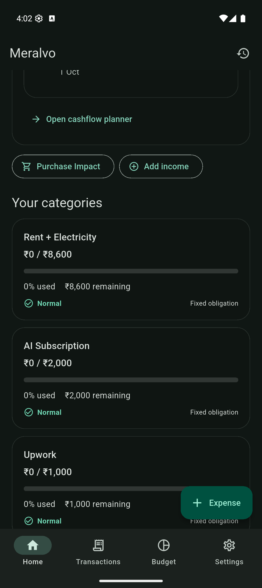

# Meralvo

**Offline Salary & Cashflow Planner**

Meralvo is a privacy-first offline salary and cashflow planning application designed to help people understand flexible money after protected savings and upcoming obligations.

## Overview

Meralvo combines monthly salary planning with additional income, savings allocation, recurring obligations, daily flexibility calculations, and a rolling cashflow forecast. It is a pre-revenue product and has not been represented as having customers, downloads, or proven demand.

## Key Features

- Salary and additional income tracking, including allocation to spending or savings
- Protected savings target and monthly category budgets
- Recurring bills and expected income
- **Daily Flexible Amount** calculation after remaining obligations
- 30-day cashflow forecast and upcoming items
- **Purchase Impact** simulation that does not create a transaction
- Expense and income history, monthly summaries, and read-only past months
- Local JSON backup and import
- Existing V1 data migration to V2
- Light and dark themes; white-label configuration

## How It Works

**Income → Protected Savings → Obligations → Daily Flexible Amount → 30-Day Forecast → Purchase Impact**

## Privacy

The application is designed to work offline. Financial records are kept in app-private local JSON storage. There is no account, backend, Firebase, analytics, advertising, or automatic cloud sync, and no recurring server-infrastructure cost. Exported backups are initiated and controlled by the user. See [Privacy](docs/PRIVACY.md).

## Screenshots

One genuine dashboard capture from the Android debug build is included below. Other screens are not represented because they were not captured.

## Technology Overview

Flutter and Dart, Material 3, Provider state management, local JSON persistence, reusable financial calculation and forecasting services, and versioned schema migration. See [Architecture](docs/ARCHITECTURE.md).

## Quality & Testing

The V2 Flutter project passes `flutter analyze` with no issues and all 37 automated tests pass. Tests cover financial calculations, persistence, migration, backup handling, and user flows. A debug APK was built successfully; production signing is pending.

## Product Status

Pre-revenue. The product is an acquisition-ready development project; no Play Store availability, user base, customer count, or revenue is claimed.

## Acquisition

Complete application source code is maintained in a private repository and is available to the buyer as part of an acquisition. The buyer package and handover scope are described in [Acquisition](docs/ACQUISITION.md).

## Contact

For product or acquisition enquiries, contact the seller through the channel used to share this listing.
